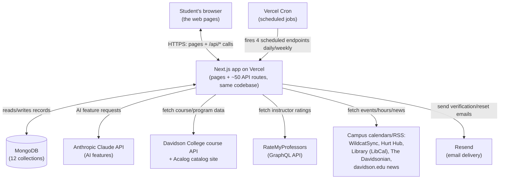

# MakeItSo — Backend Explained

*Written for a non-engineer co-founder. Every claim below cites the file (and line numbers) it comes from. "I think" marks something inferred rather than stated outright in the code. Nothing here describes a feature that isn't actually in the repository.*

Repo snapshot this document was written from: branch state as of the latest commit, `a8fb479` ("Merge pull request `hades-c/makeitso#12`"). The app is mid-rebuild — the README says so directly: "Status: being rebuilt... the course catalog, plan, careers, alumni and events data arrive in the next waves" (`README.md:9-13`).

---

## Repo map (how I found all this)

```
MakeItSo/
├── .github/workflows/ci.yml     the automated test/build pipeline (GitHub Actions)
├── .nvmrc                       pins Node.js version 24
├── vercel.json                  tells the hosting provider "this is a Next.js app"
└── frontend/                    the ENTIRE application — frontend and backend both live here
    ├── app/                    pages (what a browser renders) AND api/ (the backend's HTTP endpoints)
    │   └── api/                ~50 backend "routes" — see Section E
    ├── server/                 server-only code: database access, business logic, external calls
    ├── models/                 the 12 database table definitions ("schemas")
    ├── lib/                    code shared by both the browser-side and server-side code (types, validation)
    ├── components/             the visual building blocks of the web pages (frontend)
    ├── tests/                  automated tests, including recorded fake copies of outside services
    ├── proxy.ts                a small piece of request-routing logic (not a backend API, see below)
    └── docs/CONTRACTS.md       the project's own internal reference for its frozen interfaces
```

**There is no separate "backend" folder or "backend service."** This is one **Next.js** application (a popular JavaScript/TypeScript web framework) that serves both the web pages *and* the API in the same codebase and the same deployment. The "backend" is specifically:
- `frontend/app/api/**/route.ts` — the ~50 HTTP endpoints (an **endpoint**, a.k.a. **API** route, is a specific URL the browser can call to get or send data, like a phone extension for one function of the app)
- `frontend/server/**` — the actual logic behind those endpoints (database reads/writes, calls to Davidson's own systems, calls to the AI)
- `frontend/models/**` — the shape of each thing stored in the database

**Language, framework, database, hosting** (from `frontend/package.json:1-45`, `README.md:17-29`, `vercel.json`):
- **Language**: TypeScript (JavaScript with types checked before the code runs)
- **Framework**: Next.js 16 (React 19 for the UI)
- **Database**: MongoDB, accessed through **Mongoose** (an **ORM** — "Object-Relational Mapper" — a library that lets the code work with database records as typed JavaScript objects instead of writing raw database query language by hand)
- **Auth**: NextAuth.js v4 (a prebuilt login/session library)
- **AI**: Anthropic's Claude, via the `@anthropic-ai/sdk` package
- **Hosting**: Vercel, with the app's root folder set to `frontend` (`README.md:28`)

---

## A. One-paragraph summary

MakeItSo is one website (not two separate frontend/backend services) built on Next.js, where the same codebase renders the pages a student sees *and* answers the ~50 API calls those pages make behind the scenes. When a student does anything — signs up, adds a course to their plan, asks the AI to draft a career plan — their browser calls one of those API routes, which checks they're allowed to do that, reads or writes a record in a MongoDB database, sometimes also calls an outside system (Davidson College's own course-schedule API, RateMyProfessors, campus event calendars, or Anthropic's Claude AI), and sends back a JSON answer the page then displays. Everything is deployed on Vercel, and a handful of those same API routes are also triggered automatically on a schedule (nightly/weekly) to refresh cached copies of Davidson's course catalog, event feeds, and professor ratings so normal page loads never have to wait on a slow outside website.

## B. The tech stack

| Piece | What it is | Job it does for MakeItSo |
|---|---|---|
| **Next.js 16** (`package.json:19`) | A full-stack web framework for React | Serves the actual web pages AND the backend API routes from one codebase/deployment |
| **TypeScript** | JavaScript with a type-checker | Catches a whole class of bugs (wrong data shape) before the code ever runs |
| **React 19** | UI library | Builds the interactive page components a student sees |
| **MongoDB** | A NoSQL database (stores flexible JSON-like documents rather than rigid spreadsheet rows) | Stores every account, plan, cached AI answer, rate-limit counter, course listing, etc. — 12 collections total, see Section D |
| **Mongoose 9** (`package.json:36`) | An ORM for MongoDB | Defines what each stored record must look like and provides the functions the code calls to read/write |
| **NextAuth.js v4** (`package.json:35`) | An authentication library | Issues and verifies the signed-in session cookie (a **JWT** — see Section G) |
| **bcryptjs** (`package.json:16`) | A password-hashing library | Turns a password into an irreversible scrambled string before it's ever stored |
| **Zod** (`package.json:45`) | A schema-validation library | Checks every API request's input, and the server's own environment variables, against an exact expected shape before any code trusts them |
| **Anthropic Claude** (`@anthropic-ai/sdk`, `package.json:15`) | A large language model (AI) API | Powers 5 AI features: drafting a career plan, suggesting courses, explaining a course, summarizing professor reviews, drafting a cold email to an alum |
| **Vercel** (`README.md:28`, `vercel.json`) | A cloud hosting platform for Next.js apps | Runs the live site, runs the scheduled background jobs ("Vercel Cron"), serves the CDN cache |
| **Davidson College's public course API** (`server/catalog/upstream.ts:12`) | An outside website Davidson itself runs | Supplies the real, current list of courses/sections MakeItSo displays |
| **RateMyProfessors** (`server/http/external.ts:33`) | An outside review website | Supplies professor rating numbers (never review text — see Section H) |
| **Resend** (`server/auth/mailer.ts:114-116`) | An email-sending API | Optionally sends the real verification-code and password-reset emails |

## C. How the pieces connect



There is no separate "frontend server" and "backend server" — one Next.js process on Vercel does both. The browser never talks to Davidson, RateMyProfessors, the campus feeds, Claude, or Resend directly; only the server does, through one single gateway function (`fetchExternal`, `server/http/external.ts:159-291`) that allow-lists exactly which outside hostnames each feature may reach (`server/http/external.ts:30-42`).

## D. The data (every MongoDB collection)

All 12 are defined in `frontend/models/*.ts`. MongoDB calls a table a "collection" and a row a "document."

| Model file | Collection name | What it stores | Key fields | Relationships |
|---|---|---|---|---|
| `User.ts` | `users` | **One row per account.** Name, normalized email, bcrypt password hash, email-verification status, profile fields (majors, minors, graduation year, career interests, AI consent) (`models/User.ts:25-70`) | `_id`, `email` (unique), `password` (hidden by default), `emailVerifiedAt`, `sessionVersion` | Parent of everything else — almost every other collection is keyed by this `_id` |
| `Plan.ts` | `plans` | **One document per student** (one-to-one): their whole four-year course plan — planned/registered/completed courses, summer activities, student-entered deadlines, AI-draft suggestions, and their WebTree (registration preference) lists per term (`models/Plan.ts:111-149`) | `userId` (unique), `items[]`, `summer[]`, `deadlines[]`, `drafts[]`, `webtree[]` | One user → one plan document, containing arrays of sub-records (so "one student has many plan items" lives *inside* their single plan document, not as separate rows) |
| `legacy/CoursePlanV1.ts` | `courseplans` | The **old hackathon-era version** of a student's plan. Explicitly read-only — the comment at the top says "NEVER WRITE" (`models/legacy/CoursePlanV1.ts:1-13`). Kept only so a student's old plan can still be shown/converted until they make their first edit in the new system |
| `VerificationCode.ts` | `verificationcodes` | **One live code per (account, purpose)** — the 6-digit code emailed for "verify your @davidson.edu address" or "reset your password." The code itself is never stored, only its cryptographic hash (`models/VerificationCode.ts:9-11`) | `userId`, `purpose`, `codeHash`, `attempts`, `codeExpiresAt` | Belongs to one `User` |
| `RateLimit.ts` | `ratelimits` | **Anti-abuse counters** — e.g. "how many login attempts from this IP in the last 15 minutes," "how many password-reset emails sent to this address this hour." One document per (rule, time window) (`models/RateLimit.ts:9-24`) | `key`, `windowStart`, `count` | Keyed by a user id or an IP address, not a true relationship |
| `AiCache.ts` | `aicache_v2` | **Every AI answer ever generated**, so the same question isn't re-asked of the AI every time. Two kinds: "shared" (one course's AI explanation, shared by every student who asks) and "user" (a personal career plan draft, keyed to one student) (`models/AiCache.ts:9-23`) | `feature`, `scope`, `userId` (null for shared), `key`, `data`, `expiresAt` | "user"-scope rows belong to one `User` |
| `AiUsage.ts` | `aiusages` | **Daily AI usage counters** — how many AI calls and tokens were used, per day per feature, for billing/budget tracking | `day`, `userId`, `feature`, token counts | Deliberately **not** the real account id — see Section D's privacy note below |
| `CatalogSection.ts` | `catalogsections` | **One row per actual course section** (e.g. "CSC 221, Fall 2026, Section 01") pulled from Davidson's own course API: meeting times, instructor, credits, enrollment, requirement codes (`models/CatalogSection.ts:55-98`) | `termCode` + `crn` (unique) | Not tied to a user — this is shared reference data everyone sees the same |
| `CatalogMeta.ts` | `catalogmeta` | **Bookkeeping about the catalog sync itself** — when each term was last successfully refreshed from Davidson, error counts, a safety "lease" so two refresh jobs don't collide (`models/CatalogMeta.ts:8-26`) | `key`, `kind` | Supports `CatalogSection` |
| `Program.ts` | `programs` | **Majors/minors catalog pages** scraped from Davidson's Acalog catalog site — requirement text for each major/minor (`models/Program.ts:8-24`) | `catalogId` + `acalogId` (unique) | Shared reference data |
| `RmpTeacher.ts` | `rmpteachers` | **The weekly snapshot of every Davidson instructor on RateMyProfessors** — average rating, difficulty, number of ratings. **Explicitly never stores review text** (`models/RmpTeacher.ts:9-13`) | `legacyId` (unique) | Matched by name against `CatalogSection.instructors` at display time |
| `FeedItem.ts` | `feeditems` | **Campus events/news items** pulled from external calendars (see Section F.3) — title, time, location, which feed it came from (`models/FeedItem.ts:9-21`) | `source` + `externalId` (unique) | Shared reference data; auto-deletes itself 60 days after the event ends |
| `SourceSync.ts` | `sourcesyncs` | **Status of each outside data pull** — last success/failure time, so the UI can show "Schedule data as of [time]" (`models/SourceSync.ts:9-11`) | `sourceId` (unique) | Supports the "Sources" panel in the UI |

**What does/doesn't hold personal student data:**
- **Personal/sensitive**: `users` (name, email, password hash, major/career interests), `plans` (a student's actual courses and schedule), `verificationcodes`, and the "user"-scope half of `aicache_v2` (a student's personal AI-generated plans/emails).
- **Deliberately de-identified**: `aiusages` does **not** store the real account id. It stores a one-way cryptographic scramble of it (`userId` is "the first 12 bytes of sha256('makeitso:ai-usage:' + id)") specifically "so usage rows name no account directly" (`models/AiUsage.ts:19-24`).
- **Not personal at all**: `catalogsections`, `catalogmeta`, `programs`, `rmpteachers`, `feeditems`, `sourcesyncs` — these are shared facts about Davidson's courses, programs, professors, and events, the same for every student.
- **Alumni data is not in the database at all.** It's a hand-written, ~26-person list baked directly into the application's source code (`server/content/alumni.ts`) — see Section F.3.

## E. Every API endpoint

All ~50 live under `frontend/app/api/`. Every single one is built through one shared function, `defineRoute` (`server/http/route.ts`), which automatically: checks the HTTP method is right, blocks cross-site forgery on anything that changes data (checks the request's **Origin** header — the website it claims to come from — matches the app itself), checks who's logged in, enforces rate limits, validates the input against a strict schema, and always returns a `Cache-Control: private, no-store` header unless a route is explicitly marked public/cacheable (`server/http/route.ts:14-44`). "Logged in" below means a valid session cookie; "Verified" means logged in **and** the account's Davidson email has been confirmed via emailed code.

### Sign-up, sign-in, account

| Method & path | What it does | Input | Output | Auth |
|---|---|---|---|---|
| `POST /api/auth/register` | Creates an account (or quietly no-ops if one exists) and emails a verification code | name, @davidson.edu email, password | Always `202 {status: "check-inbox"}` — deliberately never reveals whether the email already has an account (`app/api/auth/register/route.ts:7-9`) | Public |
| `POST /api/auth/[...nextauth]` (and its sibling GET) | NextAuth's built-in sign-in/sign-out/session endpoints | email + password | A signed session cookie | Public |
| `POST /api/account/verify` | Submits the 6-digit code to confirm the student's mailbox | `code` | `{verified: true}` or a 400 with attempts left | Logged in |
| `POST /api/account/verify/resend` | Re-sends the verification code (max 3/hour) | — | `{sent: boolean}` | Logged in |
| `POST /api/auth/password-reset` | Emails a reset link + code if that address has an account | email | Always `202`, same no-op-vs-real-account secrecy as registration | Public |
| `POST /api/auth/password-reset/confirm` | Resets the password using the emailed code | email, code, new password | `204` | Public |
| `POST /api/auth/password-reset/link` | Resets the password using the emailed link's token instead of typing the code | token, new password | `{email}` | Public |
| `GET /api/auth/test-mailbox` | **Test-only.** Lets the automated test suite read the "emails" the fake console mailer sent, so tests can register → verify → sign in without a real inbox. Actively disabled everywhere except local test runs (`app/api/auth/test-mailbox/route.ts:9-17`) | email | Recent fake "sent" messages | Public, but self-disabling outside tests |
| `POST /api/account/password` | Changes the password (requires the current one) | current + new password | `204`, and signs the user out of every device | Logged in |
| `DELETE /api/account/sessions` | "Sign out everywhere" — invalidates every active session | — | `204` | Logged in |
| `GET /api/me` | Who's signed in, verified status, onboarding status | — | account summary | Logged in |
| `DELETE /api/me` | **Deletes the account** — re-asks for the password, then erases every record tied to that user across every collection | password | `204` | Logged in |
| `GET /api/me/export` | "Download my data" — everything MakeItSo stores about the student, as one JSON file (rate-limited to 5/day) | — | full data export | Logged in |

### Profile

| Method & path | What it does | Input | Output | Auth |
|---|---|---|---|---|
| `GET /api/profile` | Reads the student's profile (major, minor, grad year, interests, etc.) | — | profile | Logged in |
| `PATCH /api/profile` | Updates allow-listed profile fields only | partial profile | updated profile | Logged in |
| `PUT /api/profile/ai-consent` | Records 18+ attestation + AI consent (required before any AI feature works) | `{adultAttested: true}` | profile | Logged in |
| `DELETE /api/profile/ai-consent` | "Turn off AI features" — withdraws consent | — | profile | Logged in |

### Course catalog (public, read-only, cached)

| Method & path | What it does | Input | Output | Auth |
|---|---|---|---|---|
| `GET /api/catalog/terms` | Every academic term, with "current"/"registration" term resolved | — | terms list | Public, cached |
| `GET /api/catalog/search` | Search/filter all course sections (department, requirement, days, open seats, etc.) | query params | matching sections | Public, cached |
| `GET /api/catalog/filters` | The valid department/requirement filter options for a term | `term` | filter options | Public, cached |
| `GET /api/catalog/courses/[term]/[code]` | One course's detail for one term (e.g. `202602/CSC-221`) | — | course detail or 404 | Public, cached |
| `GET /api/catalog/availability` | Which terms a course has historically run in | `code`, `terms` | per-term availability | Public (`auth: "public"`, `lib/api/catalog.ts:81-84`); cached at the CDN once the historical backfill for the requested terms is complete, otherwise sent `private, no-store` so a still-growing answer is never cached half-finished (`app/api/catalog/availability/route.ts:6-16`) |
| `GET /api/programs` | Official major/minor names | `kind` | programs list | Public, cached |
| `GET /api/programs/[id]` | One major/minor's requirement text | — | program detail or 404 | Public, cached |
| `GET /api/ratings` | A course's instructors' RateMyProfessors numbers (reads the stored weekly snapshot only — never calls RateMyProfessors live) | `term`, `code` | ratings | Logged in, rate-limited |

### Plan (the four-year course plan — "signed-in, student's own data" for all of these)

| Method & path | What it does |
|---|---|
| `GET /api/plan` | The whole plan |
| `POST /api/plan/items` | Add a course (catalog-validated; `409` if that course+term is already active) |
| `PATCH /api/plan/items/[id]` | Update one plan item's status/pass-fail/note |
| `DELETE /api/plan/items/[id]` | Remove a plan item |
| `GET /api/plan/progress` | Degree-requirement progress (credits done/planned, which requirement slots are filled) |
| `GET /api/plan/schedule?date=` | That day's class schedule + deadlines, for the "Today" view |
| `GET /api/plan/deadlines` / `POST .../deadlines` / `DELETE .../deadlines/[id]` | Student-entered deadlines (list/add/remove) |
| `GET /api/plan/summer` / `POST`, `PATCH .../[id]`, `DELETE .../[id]` | Summer internships/research/jobs the student logs |
| `PATCH /api/plan/manual` | Language-exemption and PE-requirement checklist |
| `GET /api/plan/drafts` / `PATCH .../[id]` | AI-suggested plan drafts — list them, or accept/dismiss one |
| `GET /api/plan/webtree?term=` / `POST /api/plan/webtree` | The student's ranked course-registration preference list for WebTree (Davidson's registration lottery), with conflict/seat checking |

### AI features (all `POST`, all logged in + verified @davidson.edu + AI consent given — see Section G)

| Method & path | What it does | Rate/cache notes |
|---|---|---|
| `POST /api/ai/course-about` | Plain-English explanation of one course | Shared cache, 30 days |
| `POST /api/ai/plan-suggestions` | AI drafts which courses to take next term | Personal, cached 30 days; regenerating counts against a daily quota |
| `POST /api/ai/career-plan` | AI drafts a multi-term plan toward a chosen career path | Personal, cached 30 days |
| `POST /api/ai/cold-email` | AI drafts an outreach email to one specific, contactable alum (see Section F.3) | Personal, cached 30 days |
| `POST /api/ai/professor-summary` | Reads (never generates) a pre-written AI summary of a professor's RMP reviews | Only on if `RMP_SUMMARIES_ENABLED` (off by default) |
| `POST /api/ai/report` | "Report this" on a shared AI answer — after 3 distinct students report the same one, it's hidden pending admin review | — |
| `POST /api/ai/admin/purge` | Deletes a cached AI entry | **Admin only** (`ADMIN_EMAILS`) |

### Events, search, and the scheduled jobs

| Method & path | What it does | Auth |
|---|---|---|
| `GET /api/events` | Campus events/deadlines from the aggregated feeds, filterable by date/source/type/text | Logged in |
| `GET /api/events/library-hours?date=` | That day's library hours | Logged in |
| `GET /api/search?q=&limit=` | Unified search across courses, career paths, pages, events, and (if verified) alumni | Logged in |
| `GET /api/cron/catalog` | Refreshes the course catalog from Davidson | **Cron secret** (Bearer token), see Section I |
| `GET /api/cron/programs` | Refreshes major/minor pages from Acalog | Cron secret |
| `GET /api/cron/rmp` | Refreshes the RateMyProfessors roster | Cron secret |
| `GET /api/cron/feeds` | Refreshes all 6 campus event/news feeds | Cron secret |
| `GET /api/cron/ai` | Pre-generates shared "course about" AI answers ahead of time | Cron secret |
| `GET /api/cron/ai/professor-summaries` | Pre-generates professor-review AI summaries (only if that feature is turned on) | Cron secret |

## F. Three user journeys, traced through the code

### 1. A new student signs up and logs in

1. Browser `POST`s to `/api/auth/register` with name, `@davidson.edu` email, password. The route is `app/api/auth/register/route.ts:11-14`, which calls `registerAccount()` in `server/auth/registration.ts:175-194`.
2. The password is checked against a strict policy first — at least 10 characters, not a common password, not an obvious variant of one, not the student's own email (`server/auth/passwords.ts:123-149`) — **before** anything touches the database, so this is the only thing that can make the request fail.
3. The password is hashed with **bcrypt** (a slow, salted hashing algorithm designed to resist cracking) at "cost 12" (`server/auth/passwords.ts:30,151-153`). The plain password is never stored.
4. A new `User` document is created with `emailVerifiedAt: null` (means: "created, not yet confirmed") — `server/auth/registration.ts:130-139`.
5. A 6-digit verification code is generated, its **hash** (not the code itself) is stored in `verificationcodes`, and the actual email is sent — `server/auth/registration.ts:148-166`, `server/auth/emails.ts`, `server/auth/mailer.ts`.
6. **Whatever actually happened** (brand-new signup, address already registered, or a signup already pending), the API always answers the exact same `202 "check your inbox"` message (`server/auth/registration.ts:52-53`, `app/api/auth/register/route.ts:7-9`) — this is a deliberate privacy choice so an attacker can't use the signup form to discover which emails already have accounts.
7. The student opens the email, enters the code on the `/verify` page, which `POST`s to `/api/account/verify`. `verifyEmailCode()` (`server/auth/verification.ts:86-111`) checks the code's hash matches, hasn't expired (15 minutes), hasn't been guessed wrong too many times (5 attempts per code, 10 wrong codes/day account-wide), and then sets `emailVerifiedAt` to now.
8. To actually sign in, the student submits email + password through NextAuth's credentials form, handled by `authorizeCredentials()` (`server/auth/options.ts:113-150`). This function: rate-limits by IP (10 attempts/15 min) and by (email+IP) with an escalating backoff after 5 failures (`server/auth/options.ts:128-134`); looks up the account; and — critically — runs a bcrypt comparison **even when no account exists at all**, against a fixed dummy hash (`server/auth/passwords.ts:32-33,155-169`), specifically so that "wrong password" and "no such account" take the same amount of time and can't be told apart by timing.
9. On success, NextAuth issues a signed **JWT** (JSON Web Token — a tamper-proof cookie that encodes who's signed in) valid 14 days, carrying the account's `sessionVersion` number (`server/auth/options.ts:41,174-220`). Every later request re-checks that number against the database (`server/auth/session.ts:77-93`); bumping it (on password change, "sign out everywhere," or account deletion) instantly invalidates every outstanding session, even ones that haven't expired yet.

**Note**: email domain is *not* actually restricted at the NextAuth sign-in layer — the comment explicitly says "NO domain check: legacy non-Davidson accounts keep working" (`server/auth/options.ts:27-28`). The `@davidson.edu`-only rule is enforced at *registration* and at the *verified* gate (alumni/AI features), not on login itself.

### 2. A student creates or updates their career plan

**Adding a manual course to the plan:**
1. Browser `POST`s to `/api/plan/items` with a course code (and optionally a specific section/CRN) — `app/api/plan/items/route.ts:10`.
2. `addItemImpl()` (`server/plan/items.ts`) looks the course up against the cached catalog (`server/plan/catalog.ts`) to pull its real title, credits, and requirement codes — a code that isn't found in any ingested term is still allowed in, but flagged `unverified` (comment, `server/plan/items.ts:69-72`).
3. The write itself is a single **atomic** MongoDB update (`findOneAndUpdate` with a `$push`), not a read-modify-save — the filter requires that no other *active* item already has the same (term, course) combination, so two simultaneous requests can't both succeed and create a silent duplicate; a genuine duplicate instead gets a `409 Conflict` (`server/plan/items.ts:55-58`, `models/Plan.ts:14-17`).
4. The response includes `warnings` (e.g., "this course requires permission," "you already completed this") that never block the save — they're informational only (`server/plan/index.ts:70-75`).

**Using AI to draft a career plan:**
1. Browser `POST`s to `/api/ai/career-plan` with a chosen career slug (e.g. `"software-engineering"`).
2. The route first runs `aiGateInput()` (`server/ai/gate.ts:43-57`), which checks, in order: is AI turned on at all for this feature → is a provider actually configured (an API key present) → is the account's Davidson mailbox verified → has the student given AI consent and the 18+ attestation. Any failure short-circuits with a specific reason the frontend can show, before anything is ever sent to Claude.
3. `generateCareerPlan()` (`server/ai/features/career-plan.ts:179-226`) assembles a payload: the career path's curated public facts (name, summary, departments — `careerPayload`, `server/ai/payloads.ts:156-166`) plus an allow-listed subset of the student's own profile and plan (`studentProfilePayload`/`studentPlanPayload`, `server/ai/payloads.ts:44-57,68-72`). The allow-list is enforced in one shared module whose own comment states exactly what can never reach the model: "the student's name, e-mail address, account id, grades (or anything that implies one: failed, dropped and withdrawn items are left out), free-text bio, notes, consent dates, IP or session data" (`server/ai/payloads.ts:13-14`) — majors/minors sent are restricted to official Acalog program names, interests to known career-path slugs, and plan items to just `{termCode, courseCode, status}` for courses still actively planned.
4. It checks a cache first (`server/ai/cache.ts`) keyed to a hash of that exact input — if the student's profile and the career haven't changed, the same cached answer (good for 30 days) is served with no new AI call and no quota spent.
5. On a cache miss, it checks and spends from the student's **daily quota** (20 generations/day across all AI features, 3 regenerations/day) and the site-wide daily token budget (`server/ai/config.ts:62-65`, `server/env.ts:156-163` — default 2,000,000 tokens/day, after which AI "pauses for today" for everyone).
6. The actual call goes to the Anthropic Claude API (model `claude-sonnet-5-5`, `server/ai/config.ts:11`) with a hard per-request time budget so it can never outlive the route's own timeout.
7. The AI's answer is validated against a strict schema (course codes it suggests are checked against the *real* catalog — a hallucinated course code gets dropped, and if more than 30% of suggested courses are bogus the whole answer is rejected rather than shown, `server/ai/config.ts:84`).
8. The validated draft is saved both to the AI cache and to the student's `Plan.drafts[]` array (`server/plan/index.ts:324-329`). The student then explicitly **accepts** or **dismisses** it (`PATCH /api/plan/drafts/[id]`) — accepting runs each suggested course through the *same* validated `addItem()` path as a manual add, so AI suggestions never bypass the normal catalog/conflict checks.

### 3. A student looks up alumni/networking connections, including "Davidson Connect"

**This journey is partially real, and "Davidson Connect" specifically is not implemented at all — it is a single sentence of descriptive text, not a feature.**

What **is** real:
- `server/content/alumni.ts:56-773` contains a **hand-curated, hard-coded list of 26 named real Davidson alumni** (e.g. Stephen Curry, Clint Smith, named startup founders and professionals), each with class year, major, employer, and a LinkedIn URL, assembled by a research process and "verified" as of 2026-09-30 (comment, lines 1-33). This is baked into the application's source code — it is not a live, growing, or user-editable database table. Growing it means editing this file and redeploying.
- A student who is signed in, has a **verified `@davidson.edu`** email, and whose institution has the Alumni feature turned on, can search/browse this list (`server/search/providers/alumni.ts:1-75`, gated at lines 55-56) via `/api/search` or the alumni directory page.
- For **18** of those 26 people (the ones marked `contactable: true`; the other 8 are `contactable: false` — public figures, trustees/Board members, and college officers, excluded from cold-email by the rule stated in the module's own header comment, `server/content/alumni.ts:24`), the student can ask the AI to **draft a cold outreach email** to that specific person: `POST /api/ai/cold-email` (`server/ai/features/cold-email.ts:63-140`). The AI is given that alum's public facts and the student's profile, and always returns the draft with a literal `{{studentName}}` placeholder rather than the student's real name inserted server-side — the comment explains this is deliberate so the student's actual name is never sent to the AI provider (`server/ai/features/cold-email.ts:32-33`). The student still has to copy the draft into their own email client and send it themselves; there's no in-app messaging, no reply mechanism, and no record of whether it was ever sent.

What is **not** real:
- **"Davidson Connect" is not integrated anywhere.** A full search of the entire repository turns up exactly one mention: a plain sentence of descriptive text inside a career-services program description, telling the reader that Davidson's own third-party alumni-mentoring platform exists — `"Davidson Connect (https://davidsonconnect.com/) - alumni advice, resume reviews, practice interviews, shared-interest groups"` (`server/content/offices.ts:2342`). No code fetches from it, links to it as a clickable button, or treats it as a data source of any kind. It's informational copy, the same way that paragraph might mention "Handshake" in passing.
- There is no live alumni database, no alum-side account, no way for a student to request an alum who isn't already one of the 26, and no messaging/reply system.
- "Campus events" (WildcatSync, Hurt Hub, Library hours, The Davidsonian, etc. — see Section H) is a **completely separate feature** from alumni. It's a calendar aggregator pulling from college websites; it has nothing to do with people or networking.

## G. Authentication and security

- **Login**: email + password via NextAuth's "Credentials" provider (`server/auth/options.ts:152-173`). No third-party login (no "Sign in with Google," etc.) exists in the code.
- **Passwords**: hashed with bcrypt at cost factor 12 before storage (`server/auth/passwords.ts:30,151-153`); the plaintext is never written anywhere. The policy rejects short, common, or easily-guessed passwords, including simple leetspeak substitutions (`server/auth/passwords.ts:43-149`).
- **Sessions**: a 14-day JSON Web Token (JWT) cookie, cryptographically signed with a secret (`NEXTAUTH_SECRET`, an environment variable). Every request re-reads the account's `sessionVersion` from the database and compares it to the token's copy (`server/auth/session.ts:19-26,77-93`) — this is the mechanism behind "sign out everywhere," password-change logout, and account-deletion logout all working instantly even though the JWT itself hasn't technically expired.
- **CSRF protection** (Cross-Site Request Forgery — a stranger's website secretly making a request as if it were you): every state-changing request (`POST`/`PUT`/`PATCH`/`DELETE`) is checked against the app's own `Origin` header before anything else runs (`server/http/route.ts:188`, `server/http/origin.ts`).
- **Authorization tiers**, enforced centrally in `server/http/auth.ts:12-22,75-107`:
  - `public` — anyone, no cookie read at all
  - `user` — must be signed in
  - `verified` — signed in **and** a confirmed `@davidson.edu` address (gates alumni data and all AI features)
  - `admin` — signed in, verified, **and** the account's email is listed in the `ADMIN_EMAILS` environment variable
  - `cron` — no user at all; instead requires a secret bearer token (see below)
- **Rate limiting**: a shared MongoDB-backed counter system (`server/http/rate-limit.ts`) backs specific limits throughout — e.g., 10 login attempts/15 min per IP, 5 registrations/hour per IP, 3 verification-code emails/hour per account, 60 AI requests/10 min per user. Limits can be globally disabled, but **only** in the test environment (`EXTERNAL_MODE=fixtures`) and explicitly **never** on Vercel's production environment (`server/env.ts:282-290`).
- **Scheduled-job (cron) auth**: the 6 `/api/cron/*` endpoints require `Authorization: Bearer <CRON_SECRET>`, compared using a constant-time comparison to resist timing attacks (`server/http/auth.ts:58-69`). If `CRON_SECRET` isn't set, these routes answer `503` rather than silently running unprotected.
- **Database query safety**: Mongoose's `sanitizeFilter` is turned on globally (`server/db.ts:25`), which automatically neutralizes a known MongoDB injection trick (sending `{"$gt": ""}` as a field value to bypass a filter) on every query in the app.
- **Where secrets live**: exclusively in environment variables, validated by a strict schema at startup (`server/env.ts:54-189`) — `MONGODB_URI`, `NEXTAUTH_SECRET`, `ANTHROPIC_API_KEY`, `CRON_SECRET`, `MAIL_API_KEY`, `ADMIN_EMAILS`. **None of these are committed to the repository** — `.env.example` (`frontend/.env.example`) ships only as a template with every secret field left blank, and the real `.env.local` file is explicitly git-ignored.
- **Data sent to the AI is explicitly minimized.** A single shared module is the only path any AI prompt's student/catalog data goes through, and its own doc comment states exactly what can never reach Anthropic: "the student's name, e-mail address, account id, grades (or anything that implies one: failed, dropped and withdrawn items are left out), free-text bio, notes, consent dates, IP or session data" (`server/ai/payloads.ts:13-14`). For the cold-email feature specifically, even the student's name is kept out of the model call entirely — the AI writes a draft with a literal `{{studentName}}` placeholder, which the browser fills in afterward (`server/ai/features/cold-email.ts:32-33`, `server/ai/payloads.ts:18`).
- **One thing that looks like a hardcoded secret but isn't**: `DUMMY_PASSWORD_HASH` (`server/auth/passwords.ts:33`) is a bcrypt hash hardcoded in the source. This is intentional and not a real credential — it's the hash of a random throwaway string, used purely so a login attempt against a non-existent account still *does* a bcrypt comparison (against this fixed hash) rather than skipping it, which is what makes "wrong password" and "no such account" take the same amount of time. It unlocks nothing.
- **Nothing else in the codebase appeared to hardcode a live credential** in the files reviewed for this report; secrets consistently flow through `readEnv()`/`process.env`.

## H. Outside services the backend calls

Every single outside call in the entire server goes through one gateway function, `fetchExternal()` (`server/http/external.ts:159-291` per the module's own doc comment at lines 7-24), which **hard-allow-lists the exact hostname** each named service may reach — the complete list is `EXTERNAL_HOSTS` (`server/http/external.ts:30-42`) and nothing else; a call to any host not on this list throws `ExternalFetchError("blocked")`, even if the URL came from an upstream redirect (the gateway follows at most 3 redirects, and only within the allow-listed host).

| Service (host) | What's sent to it | What's pulled from it | What breaks if it's down |
|---|---|---|---|
| **Davidson College's own course-schedule API** (`api.davidson.edu`, `server/http/external.ts:31`) | Nothing but the request itself (no account data) | The real, current list of course sections, terms, enrollment counts, via Davidson's own JSON API — not a scrape (`server/catalog/upstream.ts:6-11`) | The catalog shown is a cached snapshot (refreshed every 15 min for the current/registration term, nightly for past terms) — a brief outage is invisible to students; a long one means the catalog goes stale, never blank, and a refresh is rejected outright if it would shrink the term's data too much (`server/catalog/config.ts:49-56`) |
| **Davidson's Acalog catalog site** (`catalog.davidson.edu`, `server/http/external.ts:32`) | Nothing | Major/minor requirement text, via Acalog's "widget API" (`server/programs/upstream.ts:14`) | **This is an unlicensed scrape, not a partnership** — Acalog is a third-party vendor product (made by Modern Campus) that actively tries to block automated access with AWS's bot-blocking firewall; the code explicitly detects the bot-challenge response (`x-amzn-waf-action` header or an empty `202`) and treats it as a failure rather than "zero programs" (`server/programs/upstream.ts:16-18`). If Acalog tightens that blocking, this source can stop working with no warning to Davidson or MakeItSo's team; the app falls back to its last good cached copy, and ultimately to a checked-in static snapshot file shipped in the code (`server/programs/snapshot.json`) if it's never synced at all |
| **RateMyProfessors** (`www.ratemyprofessors.com`, `server/http/external.ts:33`) | A GraphQL (a query language some APIs use where the caller asks for exactly the fields it wants) request for Davidson's whole teacher roster, weekly, with **no authorization header at all** (`server/rmp/roster.ts:14,27`) | Average rating, difficulty, rating count **only** — review text is explicitly never requested or stored (`models/RmpTeacher.ts:9-13`) | **This is also an unauthorized integration**: it calls RateMyProfessors' own internal website API directly, the way RMP's own site does, with no public documentation, contract, or API key — just a custom User-Agent string that identifies the app as an "independent" unofficial client (`"MakeItSo/0.2 (independent Davidson College student planner...)"`, `server/http/external.ts:46-47`). RMP could change that API's shape or block the request pattern at any time with no notice and no recourse; ratings would simply stop refreshing and quietly go stale rather than erroring |
| **Anthropic Claude API** (`api.anthropic.com`) | A prompt built from course/career/alumni facts plus an allow-listed slice of the student's profile — **never** the student's real name for cold-email drafts (`server/ai/features/cold-email.ts:32-33`) | The AI's generated text (plan drafts, explanations, email drafts) | Every AI feature answers a clear "not available"/"busy" state instead of erroring (`server/ai/client.ts:368`); the rest of the app (catalog, plan, events) is entirely unaffected since it has nothing to do with this service; already-cached AI answers keep working even during an outage |
| **Resend** (email API, `api.resend.com`, `server/http/external.ts:41`) | Verification codes and password-reset links/codes | A delivery confirmation | If `MAIL_PROVIDER` isn't configured (it defaults to `"none"` in production, `server/env.ts:229`), verification/reset emails simply can't be sent — the UI answers 503 rather than silently failing, but no student can verify their mailbox or recover a password until it's set |
| **WildcatSync** (`wildcatsync.davidson.edu`), **Hurt Hub** (`hurthub.davidson.edu`), **Library/LibCal** (`davidson.libcal.com`), **The Davidsonian** (`thedavidsonian.news`), **a Mailchimp campaign-archive digest** (`us6.campaign-archive.com`), **Davidson's main website** (`www.davidson.edu`) — all in `server/http/external.ts:34-39` | Nothing | Campus events, news, and library hours, each normalized from whatever feed format that source publishes (RSS, iCal/`.ics`, or a small scraped page) into one shared `feeditems` shape | Each source keeps showing its last successfully-fetched data if a refresh fails, tracked per-source in the `sourcesyncs` collection so an admin "Sources" status view can show which feed is stale |

**Cost/risk if any of these go down**: none of them are billed per-call in a way visible in this code except Anthropic (token-metered, and explicitly budget-capped at 2,000,000 tokens/day site-wide by default, `server/env.ts:46,156-163`, to prevent a runaway AI bill). Every other outside call is read-only and free, and the code is consistently written to degrade to "serve the last good cached copy" rather than fail the page — **but two of these integrations (Acalog and RateMyProfessors) are scraped without any documented partnership or API agreement**, which is a real legal/business-continuity exposure distinct from ordinary downtime: a technical change or a request to stop on either side could silently and permanently break majors/minors data or professor ratings, not just delay them. I think this is understated risk relative to how central "see your real degree requirements" is to the product (flagged again in Section J).

## I. Deployment

- **Where it runs**: Vercel, configured via `frontend/vercel.json` (also sets 4 scheduled jobs — see below). The project's root directory on Vercel is set to `frontend` (`README.md:28`).
- **How code gets live**: the repository's CI pipeline is GitHub Actions, defined in `.github/workflows/ci.yml`. On every push/PR it runs, in order: `npm ci` (install), typecheck, lint, format check, the automated test suite (against a temporary in-memory MongoDB and **fake recorded copies** of every outside service — `EXTERNAL_MODE: fixtures` — so CI never actually calls Davidson, RateMyProfessors, or the real feeds), a production build, a CSS-size budget check, a JavaScript-size budget check, a dependency security audit, and finally a full end-to-end browser test suite (Playwright). The build step explicitly must succeed **without** any secrets present (`# No secrets: the build must succeed without MONGODB_URI / NEXTAUTH_SECRET`), because this repo's design validates environment variables lazily, only when a route is first actually used, not at build time (`server/env.ts:8-12`). I did not find a Vercel deploy step defined in this repository itself, which is consistent with the standard Vercel setup where pushing to the connected GitHub repo triggers Vercel's own build/deploy automatically outside of this CI file — I'm inferring that because the actual deploy trigger lives in Vercel's own project settings, not in a file this repo controls.
- **Scheduled background jobs** ("Vercel Cron"), defined in `frontend/vercel.json`:
  - `/api/cron/feeds` — daily at 10:23 UTC
  - `/api/cron/rmp` — weekly, Mondays at 7:17 UTC
  - `/api/cron/catalog` — daily at 7:13 UTC
  - `/api/cron/programs` — weekly, Mondays at 6:23 UTC
  - (Two more cron-shaped routes, `/api/cron/ai` and `/api/cron/ai/professor-summaries`, exist in the code but are **not** listed in `vercel.json`'s schedule — meaning I did not find where/whether they are actually triggered on a schedule in this repository; they may be wired up outside this repo, or not yet scheduled.)
- **Environment variables needed to run it** (names only, from `server/env.ts:54-189` and `.env.example`):
  - Required: `MONGODB_URI`, `NEXTAUTH_SECRET`
  - Recommended/production-required: `APP_ORIGIN`, `NEXTAUTH_URL`
  - AI: `ANTHROPIC_API_KEY`, `AI_PROVIDER`, `AI_ENABLED`, `AI_DAILY_TOKEN_BUDGET`
  - Mail: `MAIL_PROVIDER`, `MAIL_API_KEY`, `MAIL_FROM`
  - Jobs/admin: `CRON_SECRET`, `ADMIN_EMAILS`
  - Mode/testing (never set like this in production): `EXTERNAL_MODE`, `FIXTURES_NOW`, `RATE_LIMITS`
  - Feature flags: `FEATURE_CAREERS`, `FEATURE_EVENTS`, `FEATURE_ALUMNI`, `RMP_ENABLED`, `RMP_SUMMARIES_ENABLED`
  - Other: `APP_TIMEZONE`

## J. Honest assessment — the 5 biggest weaknesses

Ranked by how much they'd matter if 5,000 students actually used this next year.

1. **The alumni network is a hardcoded list of 26 people, and "Davidson Connect" doesn't exist as a feature.** (Section F.3, D) This is the single biggest gap between what the pitch might imply and what the code does. It cannot scale — growing it requires an engineer to hand-edit a TypeScript file and redeploy. At 5,000 students, this "feature" runs out of alumni to show almost immediately, and there's no path from here to a real alumni network (no alum accounts, no opt-in pipeline, no messaging) without essentially building that system from scratch.

2. **Two core data sources — majors/minors requirements (Acalog) and professor ratings (RateMyProfessors) — are pulled by scraping a third party's site with no documented partnership, contract, or API key.** (Section H) Acalog actively runs bot-blocking (AWS WAF) against automated access, which the code has to specifically detect and work around (`server/programs/upstream.ts:16-18`); the RateMyProfessors integration calls RMP's own internal, undocumented GraphQL endpoint with a custom "independent/unofficial" User-Agent and no authorization at all (`server/http/external.ts:46-47`, `server/rmp/roster.ts:14`). Both degrade gracefully today (stale cache, never a crash), but either vendor could change their system or send a takedown request with zero notice and zero recourse — at 5,000 students relying on "see your real degree requirements," that's a legal and continuity risk, not just a bug.

3. **The product is explicitly mid-rebuild, and the README says so.** "Status: being rebuilt... the course catalog, plan, careers, alumni and events data arrive in the next waves" (`README.md:9-12`). This isn't a hidden risk — it's stated plainly in the project's own documentation — but it means a sizeable fraction of what a judge might click through could still be scaffolding rather than finished behavior. I can't tell from the code alone exactly which specific pages are "real" vs. still placeholder beyond what I traced above; that would need a working demo, not just a code read.

4. **A single-point-of-failure AI budget shared by every student.** `AI_DAILY_TOKEN_BUDGET` defaults to 2,000,000 tokens/day **across the entire site** (`server/env.ts:46,156-163`) — once hit, AI features "pause for today" for every student simultaneously, not just heavy users. At meaningful scale (5,000 students), a popular feature (say, everyone drafting a plan during registration week) could burn through that budget in minutes and silently shut off AI for the rest of the day for everyone, with no per-user fairness or queuing visible in the code.

5. **No real multi-college architecture, and email delivery silently defaults to off.** Two separate but both-real gaps: (a) nearly every data source is Davidson-specific and sometimes hardcoded — the course API host, the Acalog catalog host, RateMyProfessors' query filtered to one hardcoded Davidson school ID (`RMP_DAVIDSON_SCHOOL_ID`, `server/rmp/roster.ts:3,17`), the alumni list and career-path content — so supporting a second college means rebuilding this integration layer per school, not flipping a flag; (b) `MAIL_PROVIDER` defaults to `"none"` in production unless explicitly configured (`server/env.ts:229`), so a deployment that forgets to set it silently can't send verification or password-reset emails — no student can verify their mailbox (blocking AI and alumni access) or recover a forgotten password, with no obvious error pointing at the cause.

*(Not independently ranked, but worth flagging: I did not do a dedicated search for TODOs, dead code, or missing test coverage across the whole repository — the above is based on the structure and comments encountered while tracing the features above, not an exhaustive audit.)*

## K. Pitch prep — 8 tough technical questions

1. **"How does your alumni network actually work — is it live data?"**
   No. It's a hand-researched, hard-coded list of ~26 real, named Davidson alumni built directly into the application's source code (`server/content/alumni.ts`), compiled and "verified" as of a specific date. It does not grow on its own, there's no alum-facing signup, and there's no live data feed behind it.

2. **"What happens to the data if a student quits/deletes their account?"**
   `DELETE /api/me` re-confirms the password, then runs every registered "eraser" across every collection that holds that student's data (plan, verification codes, AI usage/cache, legacy rows) before deleting the account record itself (`server/account/erasers.ts:164-188`). There's also a one-click "download my data" export (`GET /api/me/export`) that returns everything stored about them as JSON.

3. **"How do you keep the AI from making up fake courses in a student's plan?"**
   Every AI-suggested course is checked against the real, live-synced course catalog; a course code the AI invents is silently dropped, and if more than 30% of an AI answer's suggestions are bogus, the *entire* answer is thrown out rather than shown (`server/ai/config.ts:84`). Accepting an AI draft also runs it through the exact same validated "add course" code path a manual add uses — AI suggestions never get a shortcut around the catalog or conflict checks.

4. **"What's your unit cost on AI, and what stops someone from running up your Anthropic bill?"**
   Three layers: a per-student daily quota (20 AI generations/day, 3 regenerations/day), aggressive caching (the same question from the same student, or a shared question like "explain this course," is served from a 30-day cache instead of re-asking the model), and a hard site-wide daily token ceiling (2,000,000 tokens/day by default) after which AI pauses for everyone until the next day (`server/ai/config.ts:62-65`, `server/env.ts:156-163`).

5. **"Is student data secure? How do you handle passwords?"**
   Passwords are hashed with bcrypt (never stored in plain text), with a policy that rejects weak/common/guessable passwords before they're ever accepted. Sessions are signed JWTs that get instantly revoked (even before their 14-day expiry) on password change, "sign out everywhere," or account deletion, because every request re-checks a version counter against the database. Every write to the database goes through MongoDB's injection-sanitizing filter. All secrets (database connection string, session signing key, AI key) live in environment variables, never in the code.

6. **"Does this scale past Davidson to other colleges?"**
   Not without real engineering work. Every outside integration — the course catalog API, the program/catalog site, the RateMyProfessors school filter, the alumni/career content — is specific to Davidson, often literally hardcoded (a Davidson-only API hostname, a hardcoded RateMyProfessors school ID). The architecture that makes this possible (a single gateway function with a strict per-service host allow-list, a clean separation between "curated content" and "live synced data") would transfer to a new school, but the actual data connectors would need to be rebuilt per school.

7. **"What happens if Davidson's course API, Acalog, or RateMyProfessors goes down — or decides to block you?"**
   Nothing visible to the student in the short term. Every outside data source is synced into MongoDB on a schedule and read from that cache on every page load — the live outside call only happens in the background sync job, never on a student's request. A sync failure just means the cached data goes stale (the UI shows "as of [last successful sync]") rather than the page breaking. The honest caveat: Davidson's own course API is a sanctioned first-party source, but the Acalog majors/minors catalog and RateMyProfessors ratings are pulled without a documented partnership — Acalog actively bot-blocks automated access and RateMyProfessors' endpoint is undocumented and unauthenticated (Section H). A short outage is invisible; a permanent block from either vendor would mean rebuilding that data pipeline, likely by negotiating real access, not just restarting a job.

8. **"What's actually built vs. still a placeholder?"**
   The project's own README states directly that it's "being rebuilt" and that course catalog, plan, careers, alumni, and events data "arrive in the next waves" as of this snapshot. Based on the code I traced: sign-up/login/verification, the plan CRUD operations, the catalog search/display, and all 5 AI features have real, working backend logic. The alumni/networking feature is real but intentionally small and static (see #1). I did not do a page-by-page frontend audit, so I can't give a complete inventory of what's rendered vs. functional beyond what the backend code itself supports.

## L. Glossary

- **API / endpoint**: a specific URL the app's browser code calls to fetch or send data, separate from the URLs that show a web page.
- **ORM (Object-Relational Mapper)**: a library (here, Mongoose) that lets code read/write database records as typed objects instead of writing raw database commands by hand.
- **JWT (JSON Web Token)**: a tamper-proof, signed piece of text used as a login session — the server can verify it wasn't forged without having to look anything up, though this app still re-checks the database on every request for extra safety.
- **Middleware**: code that runs before a request reaches its final handler, to do a shared check (auth, rate limiting) — in this app that role is played by the shared `defineRoute` function.
- **Environment variable**: a secret or setting (like a database address or API key) supplied to the running app from outside the code itself, so secrets never get committed to the repository.
- **Rate limiting**: capping how many times something can be done (e.g., login attempts) in a time window, to block abuse.
- **CSRF (Cross-Site Request Forgery)**: an attack where a different website tricks your browser into making a request to this app as if it were you; defended against here by checking the request's declared origin.
- **Bcrypt**: a deliberately slow password-hashing algorithm, designed to make guessing passwords from a stolen database painfully slow.
- **Hash / hashing**: a one-way scrambling function — easy to compute forward, practically impossible to reverse, used so a password or code is never stored in a form that could leak out.
- **Cron job**: a task that runs automatically on a repeating schedule (e.g., "every night at 7am") rather than in response to a user action.
- **ORM schema / model**: the strict definition of what fields a database record must have and what type each one is.
- **Cache**: a saved copy of an answer (from the database, an outside website, or the AI) kept around so the same expensive work doesn't have to be redone every time.
- **GraphQL**: a query language some APIs (here, RateMyProfessors) use, where the caller specifies exactly which fields it wants back.
- **TTL (time-to-live) index**: a MongoDB feature that automatically deletes a record once a certain time has passed (used here for expired verification codes, rate-limit counters, and old events).
- **Feature flag**: an on/off switch for a whole section of the app, set by an environment variable, so a feature can be disabled without changing code.
- **CDN cache**: a copy of a response stored at the hosting provider's edge network so repeat requests for the same public data don't have to re-run the server code at all.
